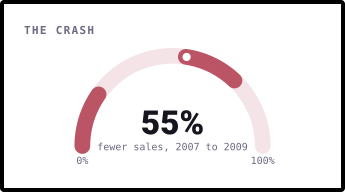
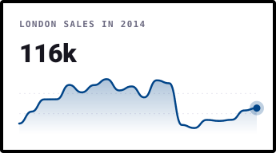
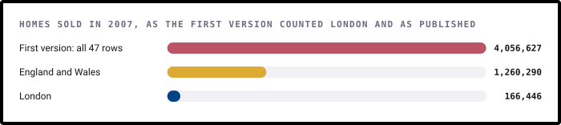
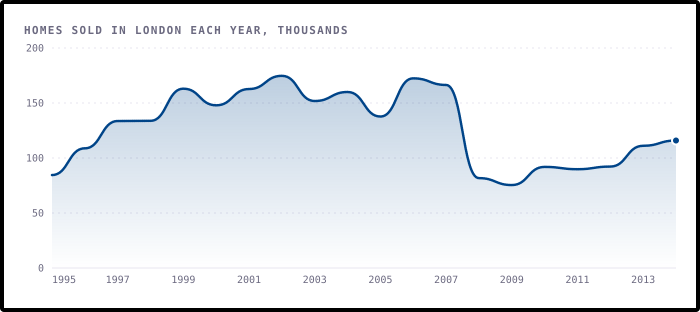
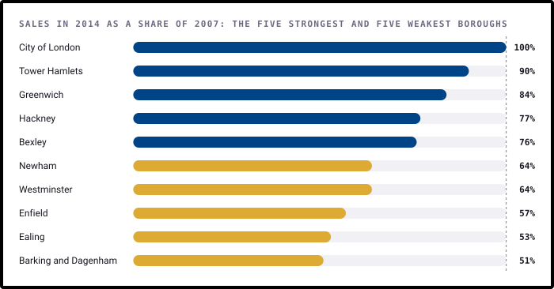
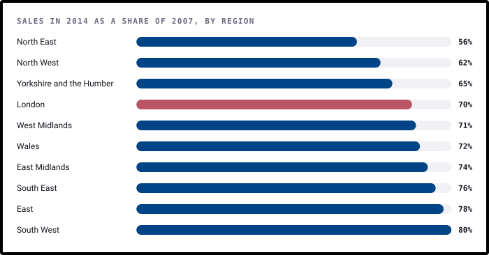

# When London Stopped Buying

**What happened to 2.6 million London home sales from 1995 to 2014, borough by borough: the boom, the crash, and
which parts of the city came back.**

[](https://github.com/ShazMoghaddam/London-Housing-Sales-Analysis/actions/workflows/checks.yml)
[](https://pypi.org/project/bezel-charts/)
[](LICENSE)

The 2008 crisis is usually told through prices. This project tells it through the number of homes that changed hands,
using HM Land Registry counts for every London borough. It starts by fixing the first version's total, which was 24 times
too big.

<p align="center">
  
  
</p>

> **Every chart here is drawn with [bezel-charts](https://pypi.org/project/bezel-charts/), an open-source Python library
> created by Shaz Moghaddam, the author of this project.** It turns pandas data into clean, self-contained SVG charts.

---

## Key findings

<!-- key-findings:start -->
### The first version's London total was 24 times too big

Its "total sales across London" added up all 47 rows of the file, including the regions, England and Wales. For 2007
that gives 4,056,627 sales. London's real figure is **166,446**.



### London's boom ended in 2002, and the crash halved what was left

Sales more than doubled from 84,539 in 1995 to 174,685 in 2002, then drifted down. From 2007 to 2009 they fell
**55%**, and in 2014 they were still 30% below 2007.



### Every borough fell, but the recovery split them

Falls ranged from 38% in Islington to 69% in Barking and Dagenham. By 2014, Tower Hamlets was back to
**90%** of its 2007 sales and Barking and Dagenham only **51%**.



### London came back more slowly than most of the country

London's sales in 2014 were 70% of 2007, the fourth weakest recovery of the 9 English regions
and Wales. Only the three northern regions did worse.


<!-- key-findings:end -->

**[Read all seven findings, and what the data can't tell you →](findings/README.md)**

| # | Finding | |
|---|---|---|
| 1 | The first version's London total was 24 times too big | It added up every row in the file |
| 2 | London's boom ended in 2002 | Five years before the crisis |
| 3 | The crash halved sales | And they stayed low |
| 4 | Every borough fell | From Islington to Barking and Dagenham |
| 5 | The recovery split the boroughs | Tower Hamlets came back, Barking and Dagenham didn't |
| 6 | Inner London came back better | Its share of sales rose |
| 7 | London came back more slowly than most of the country | Only the North did worse |

---

## Run it yourself

You'll need Python 3.11 or newer. The data is in the repo, so there's nothing to download.

```sh
git clone https://github.com/ShazMoghaddam/London-Housing-Sales-Analysis.git
cd London-Housing-Sales-Analysis
python3 -m venv .venv && source .venv/bin/activate
pip install -r requirements-dev.txt

python findings/build.py    # charts and report
pytest                      # checks the data and the numbers
```

Or open [`notebooks/london_housing_analysis.ipynb`](notebooks/london_housing_analysis.ipynb) for the same analysis with
the working shown.

## What's in the repo

```
├── data/
│   ├── housing_sales_borough.csv   The London Datastore file, unchanged
│   └── sources.json                Where it came from
├── findings/
│   ├── analysis.py                 Every calculation, as small functions
│   ├── charts.py                   Every chart
│   ├── build.py                    Writes the charts and the report
│   └── README.md                   The full report
├── notebooks/london_housing_analysis.ipynb
├── charts/                         The SVG charts
├── assets/social-preview.png       The image GitHub shows when the repo is shared
├── tests/                          Checks on the data and the findings
└── .github/                        Automatic checks and dependency updates
```

## Data

The figures are [Housing Sales](https://data.london.gov.uk/dataset/housing-sales-2r8rw) from the London Datastore,
compiled from HM Land Registry records and published under the
[Open Government Licence v2](https://www.nationalarchives.gov.uk/doc/open-government-licence/version/2/). They count homes
sold each year from 1995 to 2014, leaving out sales below market value (such as Right to Buy), under £1,000 or over
£20 million. [`data/sources.json`](data/sources.json) has the details.

Code and content in this repo are [MIT licensed](LICENSE). The data remains subject to its publisher's terms.

---

Created by **Shaz Moghaddam** · London
[Website](https://shazmoghaddam.github.io) · [LinkedIn](https://www.linkedin.com/in/shazmoghaddam)
