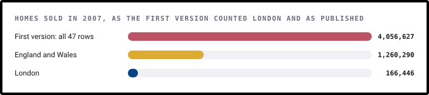
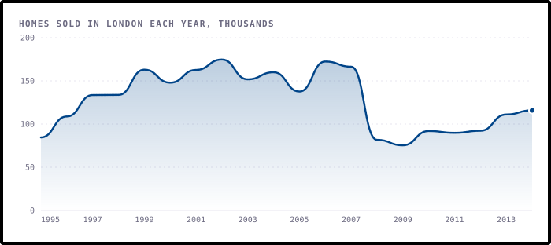
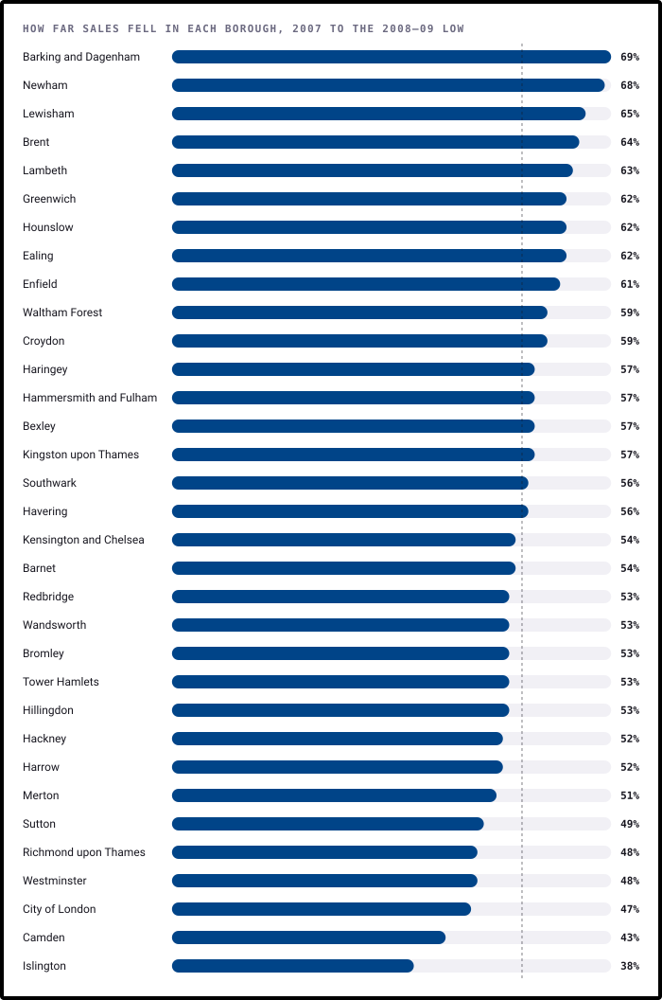
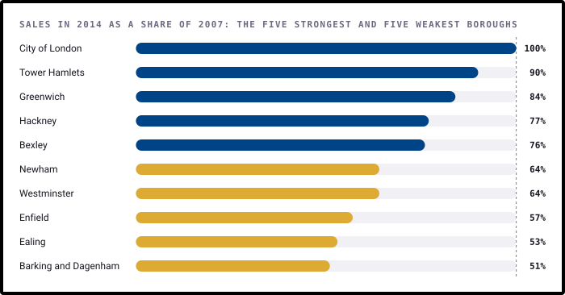
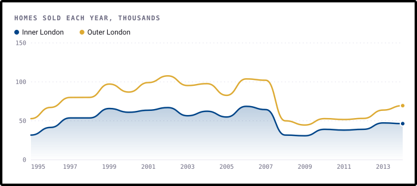
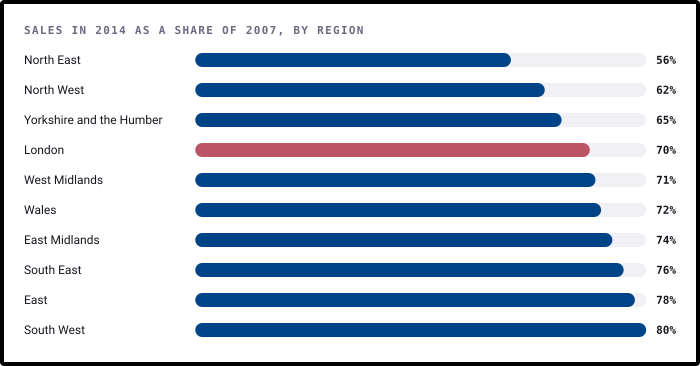

# Findings

What happened to 2,555,269 London home sales from 1995 to 2014, borough by borough. This page is written by
[`build.py`](build.py), so every number comes straight from the data.

The figures count homes sold each year, as registered with HM Land Registry. They leave out sales below market value,
such as Right to Buy, and sales under £1,000 or over £20 million. They count sales, not prices.

## 1. The first version's London total was 24 times too big

The file holds 47 rows: the 33 boroughs (counting the City of London), Inner and Outer London, the nine English regions,
England, Wales, and England and Wales together. The boroughs add up exactly to the London row.

The first version's "total sales across London" added every row together, so each London sale was counted in its borough,
in Inner or Outer London, in London, in England and in England and Wales, five times in all, along with every sale
elsewhere. For 2007 that
gives 4,056,627, more than the 1,260,290 sold in all of England and Wales.

The same mix-up affected its "highest growth borough". Dropping only the England and Wales row left England at the top, with
125,283 more sales in 2014 than 1995, and the README's answer was left as a placeholder. Everything below uses only the
rows it means to.

## 2. London's boom ended in 2002

London sold 84,539 homes in 1995 and 174,685 in 2002, a rise of 107%. Sales then drifted, and by 2007 they were
already 5% below their peak, before the financial crisis.

## 3. The crash halved sales, and they stayed low

From 2007 to 2009, London's sales fell **55%**, to 75,405. Recovery was slow: 115,898 homes sold in 2014, still 30%
below 2007.

## 4. Every borough fell, by between 38% and 69%

No borough escaped. The deepest falls were in Barking and Dagenham (69%) and Newham (68%), and the mildest in Islington
(38%). The dotted line marks London as a whole.

## 5. The recovery split the boroughs

By 2014, Tower Hamlets was back to 90% of its 2007 sales and Greenwich to 84%, while Barking and Dagenham managed 51% and
Ealing 53%. The City of London shows 100%, but it sells only a few hundred homes a year (267 in 2014), so small changes
swing it.

Boroughs that fell further tended to stay lower, but only loosely (correlation -0.37).

Volume is a different story from recovery. Across the 20 years the biggest markets were Wandsworth (136,403 sales), Bromley, Croydon and
Barnet. The first version singled out Camden for "higher overall volumes", but Camden ranks 27th of 33. Barnet, which
it also named, ranks 4th.

## 6. Inner London came back better than Outer London

Outer London's sales peaked in 2002 and Inner London's in 2006. Outer London then fell further in the crash (56% against
52%) and recovered less (68% of 2007 by 2014, against 72%).

Inner London's share of the city's sales rose from 39% in 2007 to an average of 42% in 2010 to 2013, then eased to
40% in 2014.

## 7. London came back more slowly than most of the country

London's crash (55%) was the fourth deepest of the 9 English regions and Wales, between the North East (61%) and the
South West (48%). Its recovery was the fourth weakest: 70% of 2007 sales by 2014, against
80% in the South West and 56% in the North East.

Through all of it London kept a steady share of the market, between 11% and 14% of every sale in England and Wales.

## What this data can't tell you

- **Anything about prices.** These are counts of sales. Fewer sales doesn't mean lower prices, and the data can't show
  whether homes got cheaper or dearer.
- **Why sales fell.** Mortgage rationing after 2008 is the usual explanation, but nothing here shows it.
- **Anything after 2014.** The published series ends in December 2014.
- **Every sale.** Right to Buy and other sales below market value are left out, and so are sales over £20 million,
  which matters most in central boroughs.

## How it was worked out

1. [`data/housing_sales_borough.csv`](../data/housing_sales_borough.csv) is the London Datastore file, unchanged.
2. [`analysis.py`](analysis.py) holds every calculation as a small, tested function.
3. [`charts.py`](charts.py) draws each chart with [bezel-charts](https://pypi.org/project/bezel-charts/).
4. [`notebooks/london_housing_analysis.ipynb`](../notebooks/london_housing_analysis.ipynb) walks through the same steps with the working shown.

## A correction to the first version

The first version added every row of the file into one "London" total, so its chart of total sales was mostly England and
Wales, counted twice over. Its growth table had the same problem, and the README's answer was left as a placeholder. Its
claims about Camden and Barnet were read from line charts of five boroughs. Everything here replaces that work.
